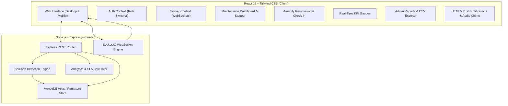
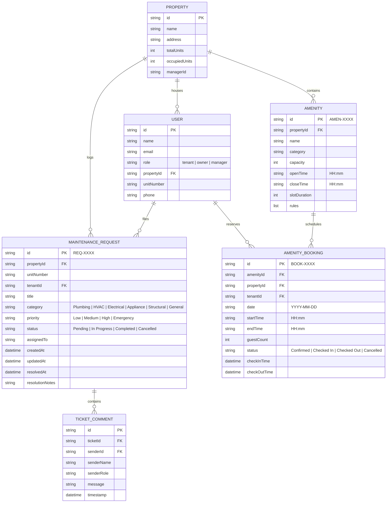
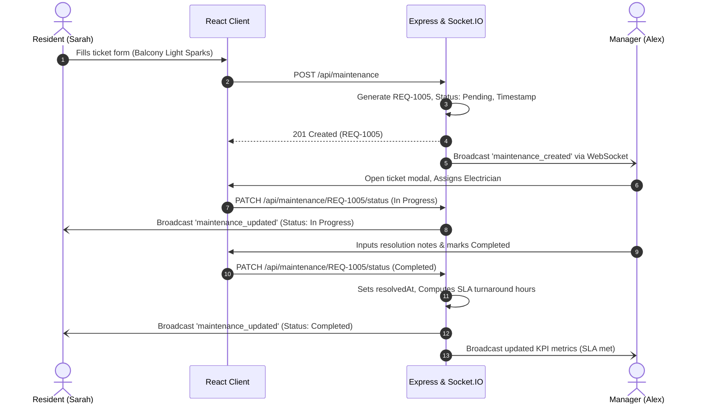
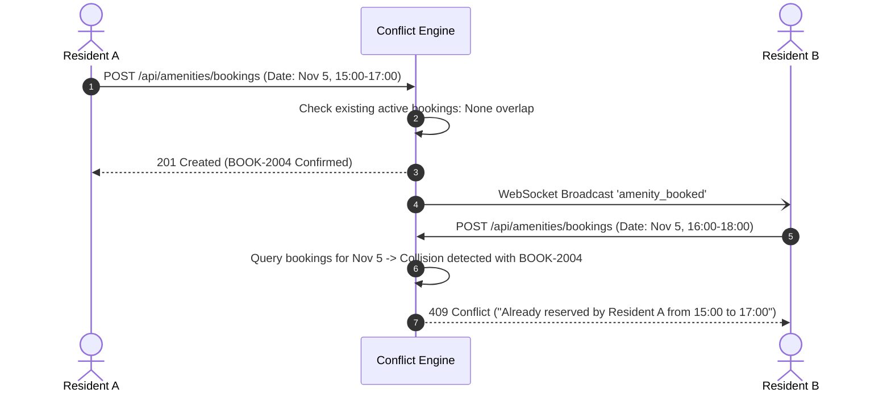

# Technical Architecture & System Design
## Real-Time Property Rental, Maintenance & Amenity Management Platform

### 1. High-Level Architecture

The platform uses a decoupled client-server architecture with bidirectional real-time event distribution:

---

### 2. Entity Relationship Diagram (ERD)

---

### 3. Real-Time Workflows

#### 3.1 Maintenance Dispatch & Real-Time Resolution SLA

#### 3.2 Amenity Conflict Prevention Engine

---

### 4. Conflict Detection Algorithm

Given two reservations $R_1$ with interval $[S_1, E_1)$ and $R_2$ with interval $[S_2, E_2)$ on date $D$ for amenity $A$:

$$\text{Overlap}(R_1, R_2) \iff \max(S_1, S_2) < \min(E_1, E_2)$$

If any existing active booking satisfies this condition, the transaction is rejected with status code `409 Conflict`. This guarantees an invariant of **zero amenity scheduling conflicts**.

---

### 5. WebSocket Event Dictionary

| Event Name | Direction | Payload | Description |
| :--- | :--- | :--- | :--- |
| `maintenance_created` | Server ➔ All | `MaintenanceRequest` object | Notifies managers of incoming ticket |
| `maintenance_updated` | Server ➔ All | `MaintenanceRequest` object | Broadcasts status change (`In Progress`, `Completed`) |
| `maintenance_comment_added` | Server ➔ Room | `{ ticketId, comment }` | Thread discussion message |
| `amenity_booked` | Server ➔ All | `AmenityBooking` object | Live update to facility schedules |
| `amenity_status_changed` | Server ➔ All | `{ booking, action }` | Check-in / check-out / cancel alerts |
| `activity_logged` | Server ➔ All | `ActivityLog` object | Audit trail event |

---

### 6. Deliverables, API Contracts & Reporting Telemetry

#### 6.1 Deliverables Mapping

| Required Deliverable | Technical Component | Architectural Proof |
| :--- | :--- | :--- |
| **Fully functional web application** | React 18 SPA + Vite (`client/dist`) + Tailwind CSS | Component architecture in `client/src/components/`, stateful React Contexts (`AuthContext`, `SocketContext`), full responsive layout. |
| **Live deployed system with real-time tracking** | Production Live: [Vercel SPA](https://prop-flow-pi.vercel.app) + [Render Backend](https://propflow-w670.onrender.com) | Sub-second WebSocket broadcasts, HTML5 Native Desktop Push Notifications, and synthesized Web Audio chime alerts. |
| **Maintenance & amenity dashboards** | `MaintenanceDashboard.jsx`, `AmenityDashboard.jsx`, `AdminReportsDashboard.jsx` | Dynamic 3-stage status stepper, interval collision prevention algorithm (`HTTP 409`), 1-click arrival check-in / departure check-out, and 1-click CSV export engine. |
| **PRD & technical documentation** | `docs/PRD.md`, `docs/ARCHITECTURE.md`, `README.md` | Formal requirements document, architecture specification, entity relationship diagram (ERD), sequence flows, and quickstart documentation. |

#### 6.2 Key Analytics & Reporting Endpoints

| Method | Endpoint | Description | Output |
| :--- | :--- | :--- | :--- |
| `GET` | `/api/analytics/kpis` | Real-time SLA benchmarks, resolution times, completion rates | JSON telemetry payload |
| `GET` | `/api/analytics/technicians` | Technician turnaround scorecard and SLA compliance | JSON array of staff performance tiers |
| `GET` | `/api/analytics/export/maintenance.csv` | Full maintenance SLA audit export | Downloadable CSV file (`propflow-maintenance-sla-report.csv`) |
| `GET` | `/api/analytics/export/amenities.csv` | Full facility utilization & check-in log | Downloadable CSV file (`propflow-amenity-utilization-report.csv`) |
| `GET` | `/api/analytics/activity` | Immutable event audit trail | JSON array of recent system events |

