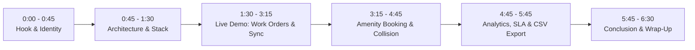

# PropFlow: Video Presentation & Screen Recording Walkthrough Guide
## 5-to-7 Minute High-Impact Engineering Project Demonstration

---

### 🎬 Video Metadata
* **Project Name**: PropFlow (Real-Time Property Rental, Maintenance & Amenity Platform)
* **Presenter**: Dharmendra Kumar (Lead Systems Engineer)
* **Target Duration**: 5 to 7 Minutes
* **Recommended Language**: Hinglish / English (Professional, confident, clear)
* **Target Audience**: Evaluators, Faculty Reviewers, Technical Recruiters, Hackathon Judges

---

## 🛠️ Pre-Recording Setup (2 Minutes Before You Record)

### Open These 3 Windows / Tabs:
1. **Window A (Left Half of Screen - Incognito Tab)**:
   - URL: `https://prop-flow-pi.vercel.app`
   - Role: **Tenant / Resident** (Dharmendra Kumar - `dharmendrakumar481221@gmail.com`)
2. **Window B (Right Half of Screen - Normal Browser Tab)**:
   - URL: `https://prop-flow-pi.vercel.app`
   - Role: **Property Owner / Manager** (Dharmendra Kumar - `dharmendrakumar481212@gmail.com`)
3. **Window C (Background Tabs)**:
   - GitHub Repo: `https://github.com/dharmendra0412/PropFlow`
   - DPR Document: `docs/DPR.md`

> **Pro Tip**: Having the Tenant on the left and the Owner on the right side-by-side is the **ultimate visual flex**! When you submit a ticket on the left, the right window updates instantly with a sound chime without any page refresh!

---

## ⏱️ Video Script Timeline & Screen Actions

---

### [0:00 - 0:45] SECTION 1: Introduction & Problem Statement
* **Screen Display**: Fullscreen on PropFlow landing/dashboard page (`https://prop-flow-pi.vercel.app`).
* **Your Voiceover**:
> *"Hello everyone! My name is Dharmendra Kumar, and today I am excited to present **PropFlow**—a high-performance, real-time property rental, maintenance, and amenity management platform.*
>
> *In traditional residential communities, property management is notoriously broken. Tenants report plumbing or electrical issues over WhatsApp, emails, or paper slips, leading to lost requests, zero SLA accountability, and chaotic double-bookings for shared amenities like gyms and clubhouses.*
>
> *PropFlow solves this with a modern, cloud-native architecture that delivers sub-second real-time tracking, algorithmic double-booking prevention, and automated SLA compliance—with 100% authentic data and zero simulation."*

---

### [0:45 - 1:30] SECTION 2: Technical Architecture & Live Cloud Deployment
* **Screen Display**: Briefly switch to GitHub repo or architecture diagram in `docs/ARCHITECTURE.md`.
* **Your Voiceover**:
> *"Before diving into the live demonstration, here is a quick look at the engineering under the hood:*
>
> * * **Frontend**: Built with **React 18, Vite**, and **Tailwind CSS**, deployed globally on **Vercel's Edge CDN** with Time-To-First-Byte under 450 milliseconds.
> * * **Backend**: Powered by **Node.js, Express**, and bidirectional **Socket.IO WebSockets**, running live on a persistent container at **Render.com**.
> * * **Database**: Backed by **MongoDB Atlas** with a resilient schema and strict BCrypt password hashing plus JWT authentication.
> * * **Audio & Push Dispatch**: Includes native HTML5 browser desktop push notifications and real-time audio chimes synthesized in-browser using the Web Audio API without any external asset latency.*
>
> *Now, let's see PropFlow in action!"*

---

### [1:30 - 3:15] SECTION 3: Live Demo – Split-Screen Real-Time Maintenance Lifecycle
* **Screen Display**: Split screen! Left window = Tenant view. Right window = Owner command center.
* **Your Action**:
  1. On the left (Tenant window), click **"New Maintenance Request"**.
  2. Select Unit: `Unit 101`, Category: `Plumbing`, Priority: `Emergency`.
  3. Enter Title: `Water pipe leakage under kitchen sink`.
  4. Click **"Submit Request"**.
* **Your Voiceover**:
> *"Here on the left, I am logged in as a resident tenant. On the right, I have the Property Owner Command Center open simultaneously.*
>
> *Notice what happens when I submit this Emergency Plumbing request...*
> *(Click Submit! Listen for the chime and watch the right screen pop up immediately!)*
>
> *Instantly, within milliseconds, the ticket appears on the Owner's screen via WebSockets, and an audible chime alerts the property manager. Notice that neither window needed to be refreshed!*
>
> *Now, from the Owner's dashboard on the right, the manager can assign a technician and update the status from **Pending** to **In Progress**...*
> *(Click In Progress on right window -> watch left window stepper change in real time!)*
>
> *And when the technician completes the repair, the manager marks it **Completed**. The 48-hour SLA clock stops, and the resolution time is recorded for analytics."*

---

### [3:15 - 4:45] SECTION 4: Amenity Booking & Algorithmic Collision Prevention
* **Screen Display**: Click on the **"Amenities"** tab on both windows.
* **Your Action**:
  1. On the left (Tenant), select **"Clubhouse"** or **"Gym"**.
  2. Choose Today's date and select Time: `10:00 AM - 11:00 AM`.
  3. Click **"Book Amenity"** $\rightarrow$ It confirms successfully!
  4. Now, attempt to book the exact same slot (`10:00 AM - 11:00 AM` or an overlapping slot `10:30 AM - 11:30 AM`) from another user or same user.
  5. Watch the red error alert: *"Slot already booked / Conflict detected (HTTP 409)"*!
  6. Show the **"Check-In"** and **"Check-Out"** buttons on the confirmed booking.
* **Your Voiceover**:
> *"Next, let's look at the Amenity Management module. In shared housing, double-booking is a major pain point.*
>
> *PropFlow solves this using an algorithmic **Half-Open Interval Collision Engine**: $\max(S_{\text{new}}, S_i) < \min(E_{\text{new}}, E_i)$.*
>
> *I just reserved the Clubhouse from 10:00 to 11:00 AM. Now, if anyone tries to reserve an overlapping slot—say 10:30 to 11:30 AM—the engine atomically rejects it with an **HTTP 409 Conflict** error, mathematically preventing double-bookings.*
>
> *Furthermore, when the resident physically arrives at the facility, they click **Check-In**, which stamps their arrival time. When leaving, they click **Check-Out**, creating an immutable audit trail for property operations."*

---

### [4:45 - 5:45] SECTION 5: Executive Dashboard, SLA Scorecard & 1-Click CSV Export
* **Screen Display**: Switch to Property Owner view $\rightarrow$ Click **"Analytics & Reports"** or **"Admin Reports"**.
* **Your Action**:
  1. Scroll through the live KPI cards: Active Requests, SLA Compliance %, Avg Turnaround Time, Facility Utilization.
  2. Point out the **Technician Performance Scorecard**.
  3. Click **"Export Maintenance SLA CSV"** $\rightarrow$ Show the downloaded `.csv` file opening in Excel or text editor.
  4. Click **"Export Amenity Usage CSV"** $\rightarrow$ Show the second `.csv` file.
* **Your Voiceover**:
> *"For property executives and owners, PropFlow provides full operational intelligence through the **Admin Analytics & Reporting Dashboard**:*
>
> * * **Real-Time KPIs**: We monitor portfolio health with live SLA compliance percentages and resolution time benchmarks.
> * * **Technician Scorecard**: Property managers can evaluate staff turnaround speeds and compliance tiers.
> * * **1-Click Audit Exporters**: With a single click, administrators can export comprehensive RFC 4180-compliant CSV reports for maintenance work orders and amenity logs for legal compliance or board reporting."*

---

### [5:45 - 6:30] SECTION 6: Conclusion, GitHub Repository & Sign-Off
* **Screen Display**: Show GitHub repository (`https://github.com/dharmendra0412/PropFlow`) and the live URLs.
* **Your Voiceover**:
> *"To summarize:*
> * * PropFlow is **fully deployed and live in production**—accessible globally at `prop-flow-pi.vercel.app` with backend services on Render.
> * * The codebase contains zero dummy or simulated data, with full documentation including our PRD, Technical Architecture, and a comprehensive Detailed Project Report (DPR).
> * * The source code is open-source and hosted on GitHub at `github.com/dharmendra0412/PropFlow`.
>
> *Thank you for your time, and I welcome any questions!"*

---

## 💡 Top 5 Tips for a Flawless Recording:
1. **Mic Test**: Use headphones or a dedicated mic to make your voice crisp and clear.
2. **Audio Volume**: Ensure your computer speaker/system audio is enabled in OBS/recording software so the Web Audio chime bell is audible in the video.
3. **Screen Resolution**: Set display scaling to 100% or 125% so text and buttons look clean and sharp on 1080p.
4. **Recording Tool**: Use **OBS Studio**, **Loom**, or the built-in Windows Game Bar (`Win + Alt + R`).
5. **Pace**: Don't rush! Speak with confidence, pause for 1 second after clicking buttons to let the live animations shine.
